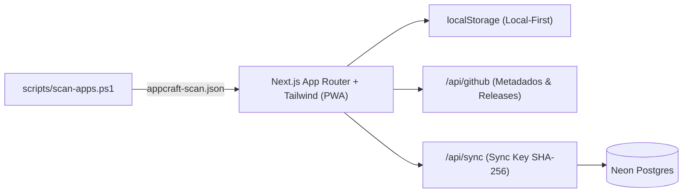

<p align="center">
  
</p>

<h1 align="center">AppCraft</h1>

<p align="center">
  <strong>Catálogo pessoal de aplicativos de PC — organize por categorias, sites oficiais, repositórios, comandos winget, notas e stacks de reinstalação.</strong>
</p>

<p align="center">
  
  
  
  
  
  
</p>

<p align="center">
  <a href="https://appcraft-nine.vercel.app">🌐 App Online</a> •
  <a href="#-primeiros-passos">⚡ Primeiros Passos</a> •
  <a href="#-scanner-windows--instaladores-do-hd">🖥️ Scanner Windows</a> •
  <a href="#-variáveis-de-ambiente">🔐 Variáveis de Ambiente</a>
</p>

---

## 🎯 O Que É & Problema Que Resolve

Deixar instaladores `.exe`/`.msi` espalhados por HDs externos faz você perder tempo procurando links oficiais, repositórios no GitHub e configurações toda vez que formata o PC.

O **AppCraft** centraliza todo o seu ecossistema de software em uma interface estilo Raycast/Linear:
- **Organização completa:** Categorias, Status (`Favorito`, `Instalado`, `Testar depois`, `Arquivado`), Tags e Perfis/Stacks (`Pós-Formatação`, `Dev Stack`, `Mídia & Design`).
- **Descoberta automática no Windows:** Script PowerShell (`scripts/scan-apps.ps1`) que lê os apps instalados e pastas de instaladores no HD, cruza com `winget list` / `winget show` em paralelo e preenche sites, repositórios, descrições e comandos `winget install`.
- **Auto-preenchimento via GitHub:** Cole a URL de qualquer repositório no modal e puxe descrição, site oficial, última release e tags automaticamente.
- **Reinstalação em 1 clique:** Exporte um único `appcraft-reinstall.ps1` (por stack ou completo) para reinstalar tudo após formatar o Windows.
- **Sync na Nuvem & PWA:** Local-first no `localStorage` com backup em JSON/Markdown e sincronização opcional via **Neon Postgres** protegida por hash SHA-256 da sua Sync Key.

---

## ⚡ Primeiros Passos

```bash
# 1. Instalar dependências
npm install

# 2. Configurar variáveis de ambiente (opcional, para Sync na Nuvem)
cp .env.example .env.local

# 3. Rodar em desenvolvimento
npm run dev
```

Acesse `http://localhost:3000` (ou use diretamente a versão publicada em [appcraft-nine.vercel.app](https://appcraft-nine.vercel.app)).

### Testes & Qualidade

```bash
npm test        # Vitest (28 testes unitários)
npm run lint    # ESLint
npm run build   # Build de produção Next.js
```

---

## 🖥️ Scanner Windows & Instaladores do HD

Execute no PowerShell na raiz do projeto:

```powershell
# Escanear apps instalados no Windows + enriquecer com winget
powershell -ExecutionPolicy Bypass -File .\scripts\scan-apps.ps1

# Escanear uma pasta de instaladores antigos no HD (.exe, .msi, .zip, .7z, .msix)
powershell -ExecutionPolicy Bypass -File .\scripts\scan-apps.ps1 -ScanFolder "D:\Instaladores"
```

Em seguida, clique em **Importar** na sidebar do AppCraft e selecione o arquivo `appcraft-scan.json` gerado (ou arraste arquivos `.exe`/`.msi` direto para a janela do navegador).

---

## 🔐 Variáveis de Ambiente

| Variável | Obrigatória | Descrição |
|---|---|---|
| `DATABASE_URL` | Não (só para Sync Nuvem) | String de conexão PostgreSQL (Neon) usada por `/api/sync`. |
| `GITHUB_TOKEN` | Não | Token GitHub opcional para aumentar o rate limit em `/api/github`. |

---

## 🏗️ Arquitetura



---

## 📄 Licença

Distribuído sob a licença **MIT**. Veja [LICENSE](./LICENSE) para mais detalhes.
